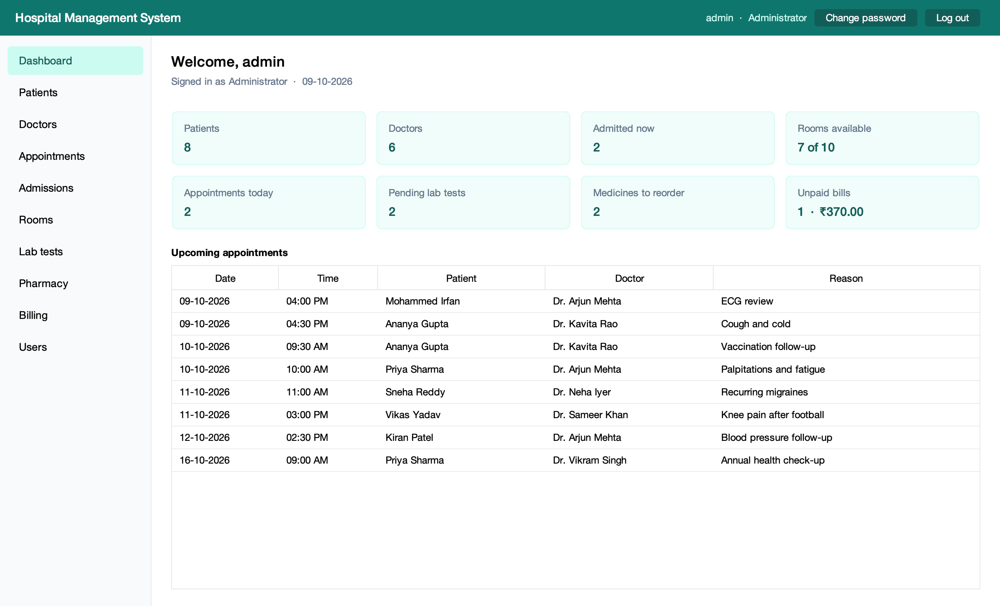
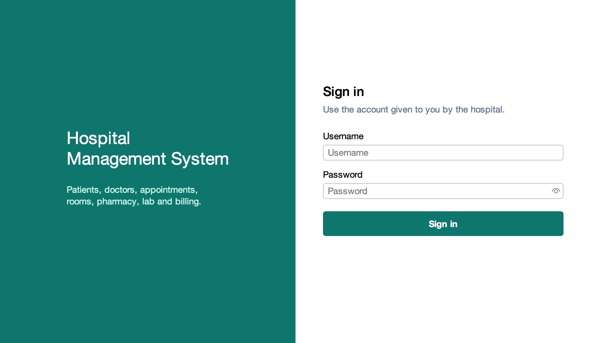
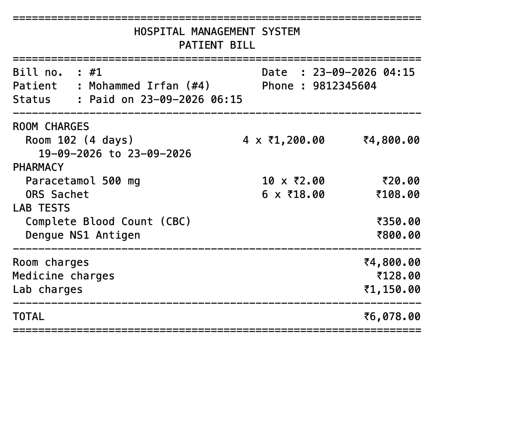
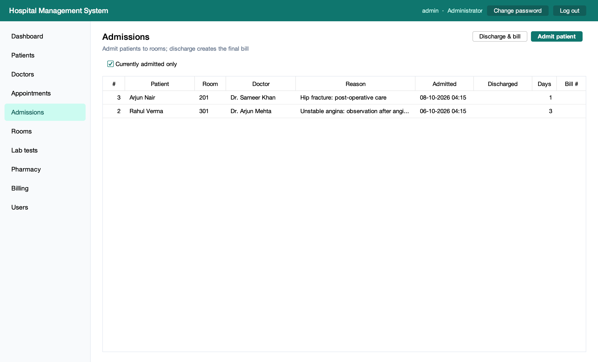
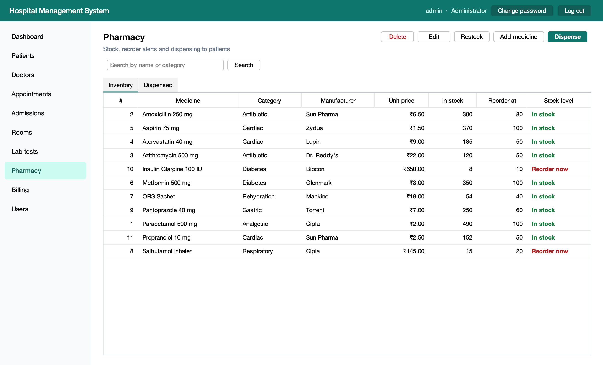
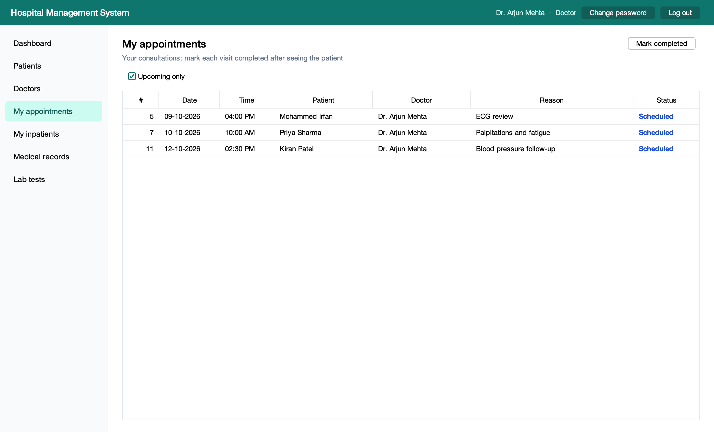
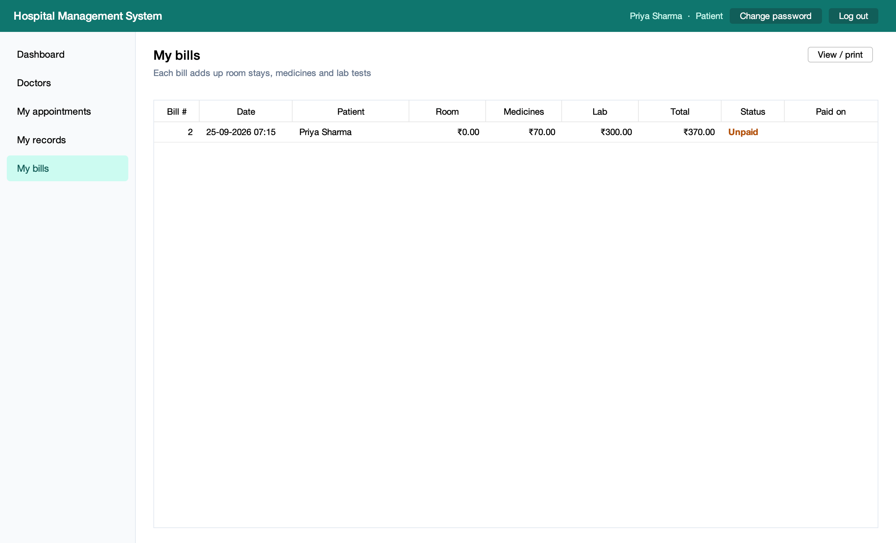
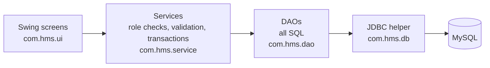
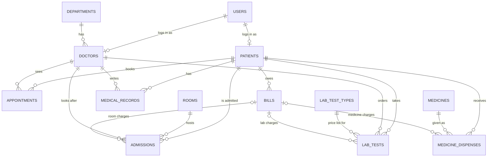

# Hospital Management System

A desktop application for running a small hospital, written entirely in **Java** (Swing user interface, JDBC data access) on a **MySQL** database.

Three kinds of users log in: **administrators**, **doctors** and **patients**. Each one sees only the screens and the data their role allows. Patients and doctors are registered, appointments booked, patients admitted to rooms, medicines dispensed and lab tests ordered. A single **bill brings together charges from three modules**: room stays, pharmacy and lab.



| | |
|---|---|
|  |  |
|  |  |
|  |  |

## Features by role

| Area | Administrator | Doctor | Patient |
|---|---|---|---|
| Patients | Register, edit, search, delete (only if no history) | Search and view | |
| Doctors and departments | Add, edit and delete doctors; add departments | View | View directory |
| Appointments | Book for anyone, cancel, mark completed | Own list, mark completed | Book a free slot, cancel own |
| Rooms and admissions | Add rooms and rates, admit, discharge | Own inpatients | |
| Medical records | No access to visit notes (clinical privacy) | Read any patient's history, write visit notes | Own history |
| Lab tests | See all, record results | Order tests; record results for their own orders | Own results |
| Pharmacy | Stock, restock, dispense, reorder alerts | | |
| Billing | Generate bills, record payment, print | | Own bills, print |
| User accounts | Create logins, reset passwords, disable accounts | | |

Everyone can change their own password.

## Design decisions

**Layered architecture.** Screens call services, services call DAOs, and DAOs are the only classes that contain SQL. The screens never touch the database.



**No SQL injection.** Every query uses `PreparedStatement` with `?` placeholders. One small class (`db/Jdbc.java`) binds the values and reads the results, so typing `' OR '1'='1` into the login box is just a wrong username (there is a test for it).

**Passwords are never stored.** Each password is hashed with PBKDF2-HMAC-SHA256 (600,000 iterations, a random 16-byte salt per user). That is built into Java, so no extra library is needed. Login compares hashes in constant time and takes the same time whether or not the username exists. The database login lives in `db.properties`, which is git-ignored, not in the source code.

**Role-based access control.** Each role maps to a set of permissions (`security/Role.java`). Services check the permission before doing anything restricted, so hiding a button is never the only protection. Doctors and patients are also limited to their own rows: a patient's queries always filter by their own patient id.

**Transactions where several tables change together.** Each of these either fully happens or is fully rolled back:

* **Admit:** claim the room, then record the stay.
* **Discharge:** close the stay, free the room, then create the final bill.
* **Dispense:** take the stock, then record the charge.
* **Create login:** create the account, then link it to the doctor or patient.

**Safe under concurrent use.** "Claim a room" is one statement, `UPDATE rooms SET status = 'OCCUPIED' WHERE id = ? AND status = 'AVAILABLE'`. If two people try at once, only one update changes a row. Stock works the same way (`WHERE stock >= ?`), so it can never go below zero.

**The database enforces the rules too.**
* Foreign keys stop orphan rows and protect history. A patient with appointments or bills cannot be deleted, and the user gets a plain-English message saying why.
* CHECK constraints reject negative prices and stock.
* UNIQUE keys stop double booking. A cancelled appointment uses a generated column that becomes NULL, and MySQL allows repeated NULLs in a unique key. So a cancelled slot can be booked again, but an active slot can never be booked twice. The same trick allows only one open admission per patient.

**Billing across three modules, without double charging.** Generating a bill first stamps the new bill's id on all of the patient's unbilled rows: finished room stays, dispensed medicines and lab tests. It then adds up only the rows carrying that id. A charge can therefore never land on two bills, and if there was nothing to bill, the transaction rolls back and no empty bill is left.

**Money is exact.** Amounts are `BigDecimal` in Java and `DECIMAL(10,2)` in MySQL, never `double`. Each charge row stores the price at the moment it happened, so changing a room rate or medicine price later never rewrites an old bill. The bill total is a generated column, so it can't disagree with its parts.

## Database

13 normalised tables (third normal form). Every table has a surrogate primary key, and every relationship is a foreign key. The one deliberate exception is the bill, which keeps its three subtotals so a printed bill never changes. The full schema, with comments, is in [`schema.sql`](src/main/resources/db/schema.sql).



## Running it

You need **JDK 21 or newer**, **Maven 3.9+** and **MySQL 8.0.16 or newer** (the first version that enforces CHECK constraints).

1. Clone the repository and go into the folder:
   ```bash
   git clone https://github.com/<your-username>/Java_HMS.git
   cd Java_HMS
   ```
2. Tell the app how to log in to MySQL: copy `db.properties.example` to `db.properties` and fill in your MySQL username and password.
3. Build and start it:
   ```bash
   mvn package
   java -jar target/hms.jar
   ```

On the first start the app creates the `hms` database and its tables, and loads demo data. There is no manual SQL step. You can also open the project in IntelliJ IDEA as a Maven project and run `com.hms.App`.

### Demo logins

| Role | Username | Password | What to try |
|---|---|---|---|
| Administrator | `admin` | `Admin@123` | Discharge Rahul Verma from Admissions to see the final bill |
| Doctor | `dr.mehta` | `Doctor@123` | Mark today's appointment completed; add a visit note |
| Doctor | `dr.rao` | `Doctor@123` | Order a lab test |
| Patient | `priya` | `Patient@123` | Book a free slot; open the unpaid bill |
| Patient | `rahul` | `Patient@123` | Currently admitted; see records and lab results |

Change these passwords (or create real accounts and disable the demo ones) before using the app with real data.

## Tests

116 JUnit 5 tests:
* **43 unit tests** run anywhere with `mvn test`. They cover password hashing, input validation, the billing arithmetic, role permissions and the SQL script reader.
* **73 database tests** run every service against a real MySQL with the demo data. They cover transactions and rollback, double booking, stock that can't go negative, bills that never double-charge, each role's access limits, SQL-injection attempts, and a check that every screen of every role loads without errors.

To run the database tests as well, point them at an empty test database. The tests wipe it, so its name must contain `test`; that is checked.

```bash
export HMS_TEST_DB_URL="jdbc:mysql://localhost:3306/hms_test?createDatabaseIfNotExist=true"
export HMS_TEST_DB_USER=root
export HMS_TEST_DB_PASSWORD=your-password
mvn test
```

GitHub Actions runs all 116 tests against MySQL 8.4 on every push (`.github/workflows/ci.yml`).

## Known limitations

What a production version would change:

* **Database calls run on Swing's event thread.** With MySQL on the same machine they take milliseconds. Over a slow network, a `SwingWorker` would keep the window responsive.
* **Each query opens its own connection.** That is fine for one desk. A multi-user server would use a connection pool such as HikariCP.
* **Disabling an account takes effect at the next login.** A session that is already open keeps working until it logs out.
* **The app and MySQL should share a clock.** Times written by the app come from Java, while the demo data uses MySQL's `NOW()`, so both should run on the same machine or in the same time zone.

## Project structure

```
src/main/java/com/hms
├── App.java            start-up: config, create tables, show sign-in
├── config/             DbConfig: reads db.properties / environment variables
├── db/                 Database, Transaction, Jdbc (the only JDBC code), schema set-up
├── dao/                one DAO per table group; every SQL statement lives here
├── model/              records (Patient, Doctor, Bill, ...) and status enums
├── security/           roles, permissions, PBKDF2 password hashing, session
├── service/            business rules, validation, role checks, transactions
├── ui/                 Swing screens (one per sidebar entry) and shared widgets
└── util/               money and date formatting
src/main/resources/db   schema.sql and demo-data.sql
src/test/java/com/hms   unit and database tests; tools/Screenshots renders the images above
```

The screenshots are rendered without opening a window: run `com.hms.tools.Screenshots` from the test sources with `HMS_TEST_DB_URL` set.
